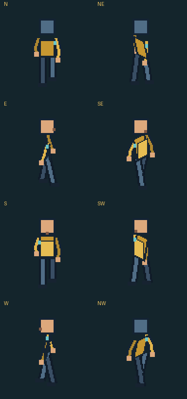

# SpriteForge

Nossa oficina de sprites para o tabuleiro da Equipe Hydra: personagens, NPCs e monstros com arquivos reproduzíveis e revisão visual por direção.

**Primeira entrega: ferramenta técnica funcionando. Os quatro protagonistas ainda não foram desenhados ou animados nesta versão.** O Alosi é o piloto previsto. O manequim abaixo é apenas um teste de exportação, câmera e movimento; seu estilo não é uma proposta aprovada.



## Usar direto no GitHub

1. Abra [Actions → SpriteForge](https://github.com/FelipeSiqueiraDev/SpriteForge/actions/workflows/sprites.yml).
2. Abra a execução mais recente. Para repetir, use **Run workflow → main**.
3. Após a execução concluir, baixe o pacote **spriteforge-…**, na seção **Artifacts**.
4. Extraia o ZIP e abra `training-dummy/index.html` para conferir as oito direções. Essa prévia funciona sem servidor e sem conexão, desde que os PNGs estejam na mesma pasta.

O GitHub pode pedir login para baixar o pacote. Não precisa instalar Python ou Aseprite no seu computador para gerar as exportações. A versão inicial não publica uma página na web; a prévia interativa vem dentro do ZIP.

O código e os arquivos de origem são permanentes no repositório. Os pacotes de Actions ficam disponíveis por 30 dias e podem ser regenerados. Sprites aprovados deverão entrar em `characters/`, junto de suas origens, para não depender da retenção dos pacotes.

## O que já funciona

- PNGs separados, spritesheet por ação e atlas JSON com coordenadas, tempos e ponto de apoio.
- GIF por direção e prévia com pausa, avanço por frame, velocidade e guia do ponto de apoio.
- Validação de oito direções, quantidade de frames, tamanho, arquivos ausentes, margem e transparência binária.
- Relatório de possíveis mudanças de altura, paleta excessiva ou pés/objetos distantes do ponto de apoio.
- Testes que verificam a preservação de **cada pixel** entre os PNGs de origem e as exportações.
- Teste de navegador na nuvem para os controles da prévia e larguras de celular/desktop.

**O código não reconhece automaticamente óculos, roupa ou identidade.** Também não prova que a caminhada está correta. O ponto de apoio é declarado no manifesto; o relatório mede pixels visíveis, não articulações ou contato real dos pés. Essas decisões precisam de revisão visual.

## Primeiro padrão, ainda provisório

| Item | Valor inicial |
| --- | --- |
| Célula | 96 × 96 px; configurável por personagem |
| Direções / linhas | N, NE, E, SE, S, SW, W, NW |
| Walk | 6 frames por direção, 100 ms por frame |
| Idle | 4 frames por direção, 200 ms por frame |
| Apoio no manequim | x=48, y=80 |
| Transparência | Alpha 0 ou 255; sem antialiasing |
| Exportação | Sem redimensionar ou recortar a arte |

**N significa para cima da tela; E, para a direita.** São direções de tela, não os eixos do mapa isométrico. Não espelhamos direções automaticamente: detalhes assimétricos precisam ser preservados.

O tamanho da célula não define a altura desenhada de todos os personagens. Não igualamos alturas artificialmente. Precisamos avaliar o modelo aprovado do Alosi e o mapa antes de fixar a câmera, escala e proporções finais.

## Estrutura

```text
characters/protagonistas/alosi/   piloto previsto, ainda sem sprites finais
characters/npcs/                 futuros NPCs
characters/monsters/             futuras criaturas
src/spriteforge/                 validação, exportação e manequim reproduzível
tests/                          integridade dos arquivos e contrato
docs/                           padrão e processo artístico
previews/                       exemplo reproduzível mostrado neste README
.github/workflows/               execução e exportação na nuvem
```

## Cadastrar um personagem

Use o formato documentado em [docs/manifest.md](docs/manifest.md). Crie os frames aprovados dentro da pasta do personagem e um `manifest.json` que lista cada PNG na ordem da animação. O próximo commit dispara o workflow e exporta todos os manifestos em `characters/`.

Os manifestos das ações completas exigem oito direções. Estudos incompletos ficam em uma pasta `studies/`, sem `manifest.json`, até serem aprovados.

Para desenvolvimento em um ambiente de nuvem:

```bash
python -m pip install .
python -m unittest discover -s tests -v
spriteforge demo --output demo-input
spriteforge validate demo-input/training-dummy/manifest.json
spriteforge build demo-input/training-dummy/manifest.json --output dist
```

Referências técnicas: [Pillow — GIF e PNG](https://pillow.readthedocs.io/en/stable/handbook/image-file-formats.html) e [GitHub — arquivos gerados por workflows](https://docs.github.com/pt/actions/tutorials/store-and-share-data).
