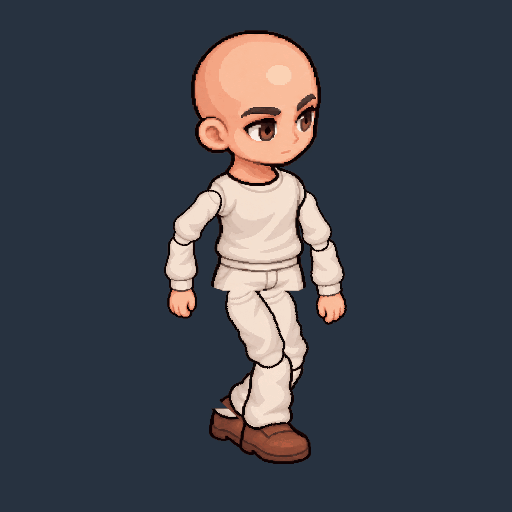
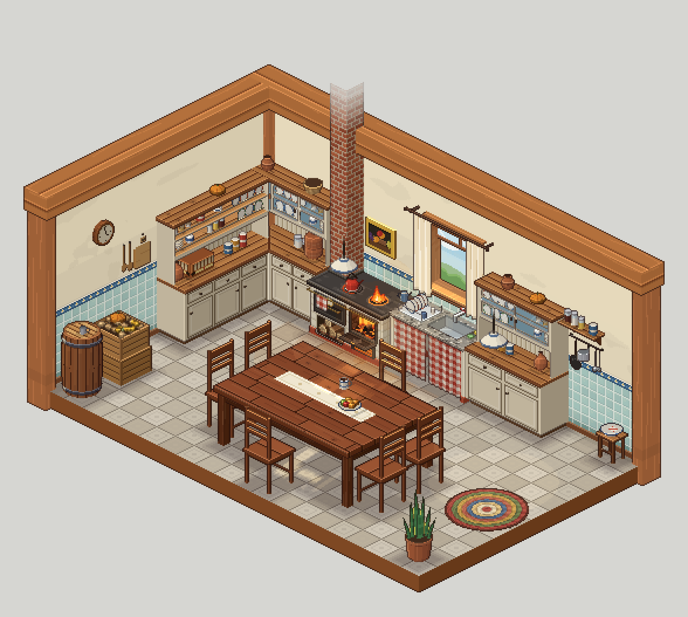
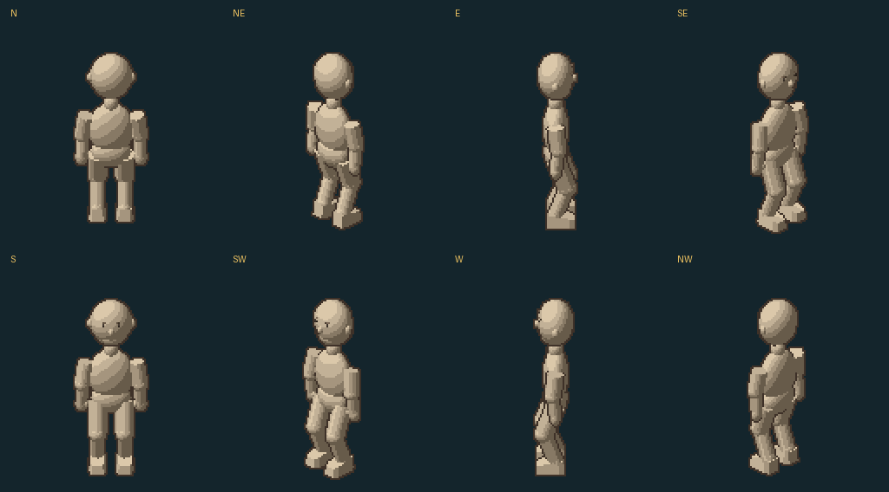
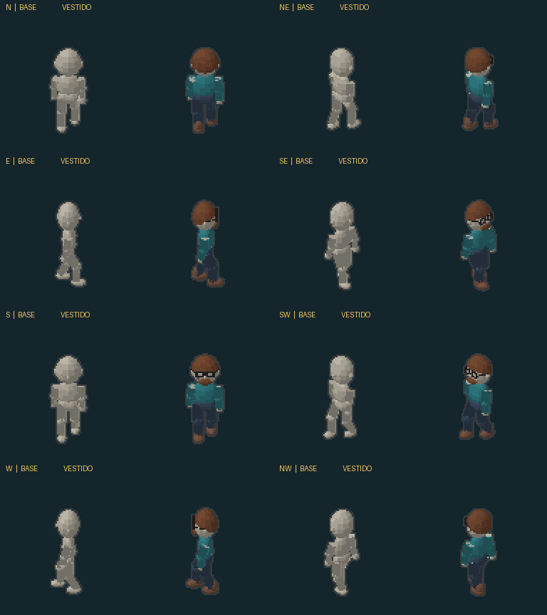

# SpriteForge

**Revisão visual: movimento contínuo do carequinha.** Após a rejeição do manequim v3 e das variações no primeiro loop desenhado, a nova prova usa um único conjunto de peças 2D, cabeça fixa e membros articulados. São **32 quadros em 960ms**, em uma vista. [Origem, prompts, geração e limites](art-direction/chibi-reference-puppet/README.md).



O rosto usa os mesmos pixels em todos os quadros. Ombros, cotovelos, quadris e joelhos seguem articulações com comprimentos constantes; o sapato não gira junto com a canela durante o apoio. Ainda há emendas de peças e limites do movimento 2D. Esta prova não está calibrada nem instalada no CRONA e não é a entrega final em oito direções.

[Arte original e referências](art-direction/chibi-v3/README.md) · [Estudo procedural rejeitado](docs/chibi-animation.md).

No pacote de Actions, abra `previews/reference-puppet/preview.html` para pausar, avançar quadros, mudar a velocidade ou escolher repouso. O HTML é autossuficiente. O `wardrobe.html` e `previews/reference-walk/` preservam os estudos anteriores para comparação. Os protagonistas ainda não estão prontos.

Nossa oficina de pixel art para o tabuleiro da Equipe Hydra: personagens, NPCs, monstros e skins dos lugares existentes no CRONA.

**Skins de ambientes:** o CRONA define a planta e os móveis; o SpriteForge organiza a aparência sobre os mesmos IDs. Primeiro lote: nove modelos da cozinha, 40 PNGs nos quatro giros e estados, mais piso e paredes nativos. O catálogo registra 268 objetos e deixa os outros 259 na fila deste perfil. A seleção de skin por cômodo ainda precisa ser integrada no CRONA com o Claude.



Prévia produzida pelo renderizador que já existe no CRONA. [Ver as nove peças separadas](previews/cozinha-skins-moveis.png) · [Como gerar as skins e consultar a fila](docs/skins.md) · [Contrato e instalação para o Claude](docs/handoff-claude-skins.md) · [Actions → CRONA Skins](https://github.com/FelipeSiqueiraDev/SpriteForge/actions/workflows/skins.yml).

**Corpo-base refinado v2:** cabeça menor, mãos e pés mais definidos, rosto básico e blocos de sombra sem as manchas triangulares da primeira malha. Manequim neutro em oito direções, com idle e caminhada; as peças seguem as mesmas poses. [Comparar antes e depois](previews/humanoid-before-after.png). Os quatro protagonistas ainda não foram produzidos; o Alosi continua sendo o piloto previsto após aprovação visual do corpo-base.





As prévias são estudos para aprovação, não personagens finais. O exemplo vestido não é o Alosi. [Como o corpo e as peças funcionam](docs/modular-body.md).

**Câmera conferida com o CRONA:** inclinação de 30°, piso 64×32 e escala nativa do jogo. A correspondência entre `Token.dir` e as oito vistas está explícita. [Ver o manequim no piso do CRONA](previews/crona-isometric.png) · [Ver a caminhada no piso](previews/crona-walk.gif) · [Contrato de integração](docs/crona-integration.md).

## Usar direto no GitHub

1. Abra [Actions → SpriteForge](https://github.com/FelipeSiqueiraDev/SpriteForge/actions/workflows/sprites.yml).
2. Abra a execução mais recente. Para repetir, use **Run workflow → main**.
3. Após a execução concluir, baixe o pacote **spriteforge-…**, na seção **Artifacts**.
4. Extraia o ZIP e abra `wardrobe.html` para alternar entre corpo-base e aparência de teste, nas oito direções. Essa prévia funciona sem servidor e sem conexão, desde que os PNGs estejam nas pastas exportadas.

O GitHub pode pedir login para baixar o pacote. Não precisa instalar Python ou Aseprite no seu computador para gerar as exportações. A versão inicial não publica uma página na web; a prévia interativa vem dentro do ZIP.

O código e os arquivos de origem são permanentes no repositório. Os pacotes de Actions ficam disponíveis por 30 dias e podem ser regenerados. Sprites aprovados deverão entrar em `characters/`, junto de suas origens, para não depender da retenção dos pacotes.

## O que já funciona

- PNGs separados, spritesheet por ação e atlas JSON com coordenadas, tempos e ponto de apoio.
- GIF por direção e prévia com pausa, avanço por frame, velocidade e guia do ponto de apoio.
- Validação de oito direções, quantidade de frames, tamanho, arquivos ausentes, margem e transparência binária.
- Relatório de possíveis mudanças de altura, paleta excessiva ou pés/objetos distantes do ponto de apoio.
- Testes que verificam a preservação de **cada pixel** entre os PNGs de origem e as exportações.
- Teste de navegador na nuvem para os controles da prévia e larguras de celular/desktop.
- Corpo-base articulado, roupas seguindo membros e acessórios acompanhando a cabeça.
- Composição por profundidade e receitas de aparência reproduzíveis.
- Exportação adicional no formato `anim.json` versão 2 do CRONA, sem instalar os estudos no jogo.

**O código não reconhece automaticamente óculos, roupa ou identidade.** Também não prova que a caminhada está correta. O ponto de apoio é declarado no manifesto; o relatório mede pixels visíveis, não articulações ou contato real dos pés. Essas decisões precisam de revisão visual.

## Primeiro padrão, ainda provisório

| Item | Valor inicial |
| --- | --- |
| Célula do rig | 128 × 128 px; PNGs externos podem usar outras células |
| Direções / linhas | N, NE, E, SE, S, SW, W, NW |
| Walk | 6 frames por direção, 100 ms por frame |
| Idle | 4 frames por direção, 200 ms por frame |
| Apoio no corpo-base | x=64, y=112 |
| Transparência | Alpha 0 ou 255; sem antialiasing |
| Exportação | Sem redimensionar ou recortar a arte |

**N significa para cima da tela; E, para a direita.** São direções de tela, não os eixos do mapa isométrico. Não espelhamos direções automaticamente: detalhes assimétricos precisam ser preservados.

O tamanho da célula não define a altura desenhada de todos os personagens. Não igualamos alturas artificialmente. A câmera e a escala foram conferidas com o código do CRONA; proporção e qualidade artística continuam em estudo para aprovação visual.

## Estrutura

```text
characters/protagonistas/alosi/   piloto previsto, ainda sem sprites finais
characters/npcs/                 futuros NPCs
characters/monsters/             futuras criaturas
templates/humanoid/              corpo-base e aparência de teste
src/spriteforge/                 rig, composição, validação e exportação
tests/                          integridade dos arquivos e contrato
docs/                           padrão e processo artístico
previews/                       exemplo reproduzível mostrado neste README
.github/workflows/               execução e exportação na nuvem
```

## Cadastrar um personagem

Use o formato documentado em [docs/manifest.md](docs/manifest.md). Crie os frames aprovados dentro da pasta do personagem e um `manifest.json` que lista cada PNG na ordem da animação. O próximo commit dispara o workflow e exporta todos os manifestos em `characters/`.

Os manifestos das ações completas exigem oito direções. Estudos incompletos ficam em uma pasta `studies/`, sem `manifest.json`, até serem aprovados.

Para desenvolvimento em um ambiente de nuvem:

```bash
python -m pip install .
python -m unittest discover -s tests -v
spriteforge demo --output demo-input
spriteforge validate demo-input/training-dummy/manifest.json
spriteforge build demo-input/training-dummy/manifest.json --output dist
```

Referências técnicas: [Pillow — GIF e PNG](https://pillow.readthedocs.io/en/stable/handbook/image-file-formats.html) e [GitHub — arquivos gerados por workflows](https://docs.github.com/pt/actions/tutorials/store-and-share-data).
