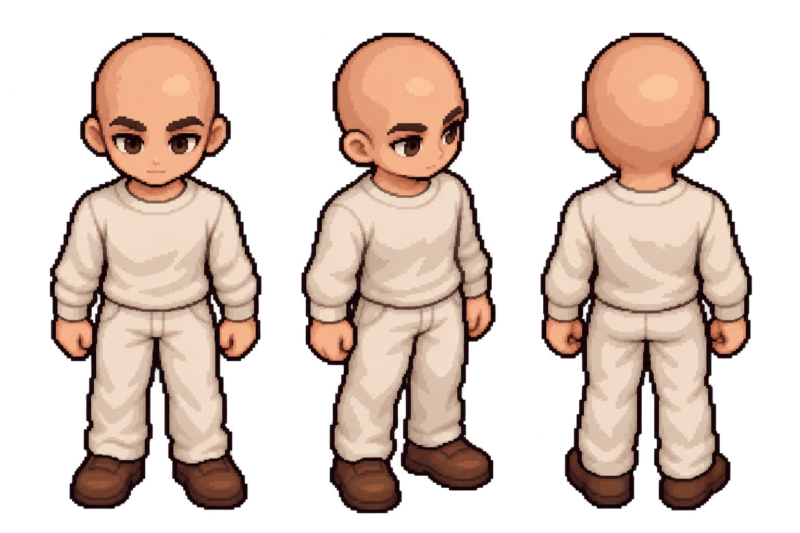

# Direção visual chibi recuperada

`approved-concept.png` é o arquivo original de três vistas aprovado pelo usuário na conversa de 14/10/2026. Foi preservado sem alteração. SHA-256: `4297826ff6d1fce25cdb93d6fd9da041ce83f0ef86e53884bb205f52ecd5dd4c`.

O usuário considerou o manequim v2 achatado, arredondado e com cabeça oval. Pediu proporções coerentes entre ângulos, respeitando a anatomia estilizada chibi. A referência aprovada orienta cabeça/rosto, silhueta, roupa clara simples e sapatos marrons.

Referências originais enviadas pelo usuário:

- `reference-proportions.png`: proporções e poses de animação.
- `reference-front.png`: aparência do personagem em diagonal frontal.
- `reference-back.png`: aparência por trás.

As duas referências de personagem não transformam a aparência genérica de teste em um protagonista final. A identidade e suas peças específicas precisam de produção própria.

`turnaround-guide.png` é uma nova extensão visual em oito vistas, produzida com a ferramenta imagegen integrada a partir da proposta aprovada. O prompt dessa geração está em `turnaround-prompt.txt`. É um guia artístico, com fundo visível; não é um atlas de jogo, não passou pela validação de alpha e não substitui os frames renderizados. Esta extensão ainda não recebeu uma aprovação independente do usuário.

O prompt original da proposta de três vistas não foi recuperado. O texto novo não deve ser apresentado como o prompt histórico.

A base articulada correspondente está em `templates/humanoid/chibi-base.json`; sua implementação está em `src/spriteforge/chibi.py`. O registro do rig usa `chibi-v3-study` e a exportação mantém o contrato do CRONA.
